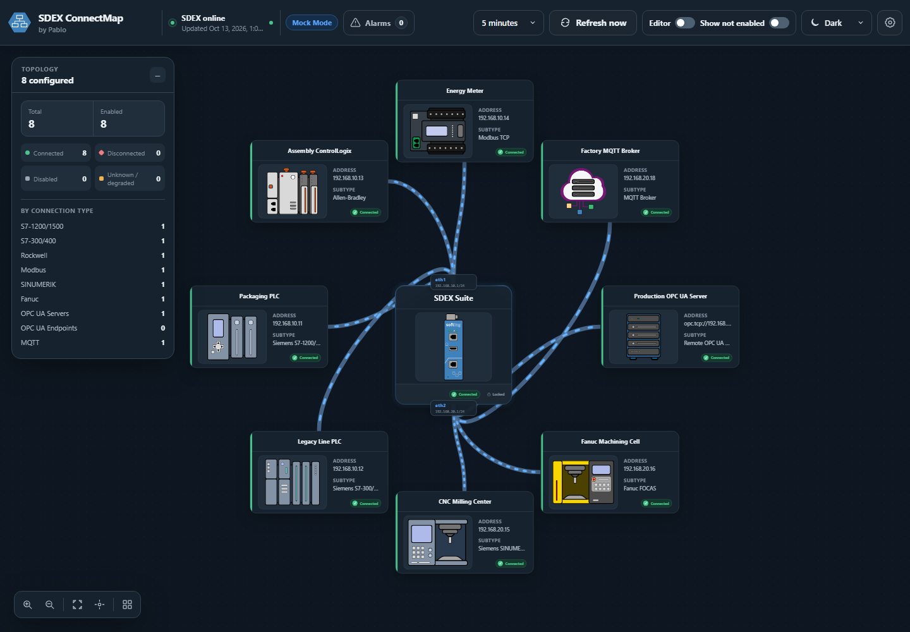
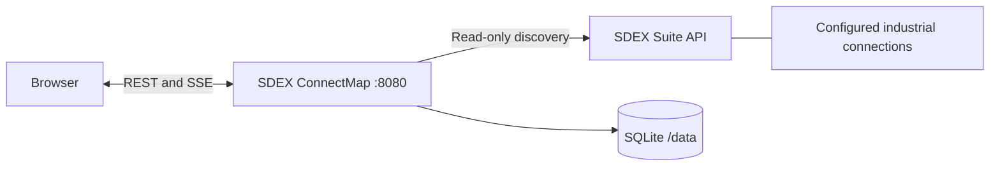

# SDEX ConnectMap

**A read-only topology viewer for industrial connections managed through SDEX Suite.**

I built SDEX ConnectMap to make SDEX connections easier to understand on an industrial edge gateway: one map for configured devices, connection states and the network paths that can be resolved from the available data. The application runs in a single container and keeps its layout and settings locally.

> **Independent project.** SDEX ConnectMap integrates with SDEX Suite. It is not an official Softing product and does not imply Softing endorsement or certification.

## The map at a glance



*Synthetic connection topology in Mock Mode: device states, interface paths and the shared SDEX gateway. [View the light theme](imgs/topology-light.png).*



ConnectMap communicates with the **SDEX server**, rather than connecting to PLCs, CNCs or brokers itself. Portainer can deploy the container, but it is not a runtime dependency. Rack and Switch elements represent the map's visual organization; they do not discover physical switches or change industrial network configuration.

## What I built

- **Connection discovery:** Siemens S7-1200/1500, S7-300/400, Rockwell/Allen-Bradley, Modbus, SINUMERIK, Fanuc, OPC UA and MQTT adapters for the configuration exposed by SDEX.
- **Status and diagnostics:** connected, disconnected, disabled, unlicensed, degraded and unknown states; partial discovery, cached-data warnings and active alarms.
- **Interactive topology:** pan, zoom, fit, movable cards, connection details and saved positions. Resolved device paths terminate at `eth1` or `eth2` on the SDEX gateway.
- **Visual editing:** Rack grouping, Switch elements, cable waypoints, orthogonal bends, colors and animation direction, with session undo/redo for visual edits. Saved edits are stored in ConnectMap.
- **Shared refresh:** manual refresh and selectable intervals of 1, 5, 10, 15, 30 or 60 minutes. Browser tabs receive Server-Sent Events and read the same backend snapshot.
- **Persistent configuration:** SQLite, Fernet-encrypted SDEX passwords, retained map settings and automatic schema initialization.
- **Offline demonstration:** clearly labeled Mock Mode with synthetic connections and failure scenarios.
- **Container deployment:** non-root runtime, read-only root filesystem, dedicated data volume, local frontend assets and an application healthcheck.

SDEX reads are limited to system information, network interfaces and supported connection modules. Login, session refresh and logout are the only SDEX POST operations. ConnectMap does not write device values, create SDEX connections or alter SDEX settings.

## Requirements and compatibility

| Component | Requirement |
| --- | --- |
| Docker | Linux containers; Docker Compose v2 for the supplied Compose file |
| SDEX | Reachable SDEX Suite HTTP API with nonce-based password authentication and permission to read the required modules |
| Portainer | Optional deployment interface for a Docker environment |
| Browser | Modern browser with JavaScript, SVG and Server-Sent Events; browser tests use Chromium |
| Source development | Python 3.12 and Node.js 22; locked Python and npm dependencies |
| Image targets | Linux AMD64 and ARM64; native container acceptance is recorded in the release audit |

I have field-tested the application in containers on Raspberry Pi and edgeNode, including communication with a real SDEX API. This is maintainer-reported operational experience, not a claim that every supported SDEX module or the exact published commit was independently tested in that environment. The [release audit](RELEASE_AUDIT.md) separates that field experience from the automated checks for the published source.

## Quick start: offline demo

From the repository root, in PowerShell:

```powershell
Copy-Item .env.example .env
$env:CONNECTMAP_MOCK_MODE = 'true'
docker compose config --quiet
docker compose up -d --build
docker compose ps
```

Open **http://localhost:8080**. The interface displays **Mock Mode** and uses synthetic data without contacting SDEX. Choose a refresh interval, open connection details and try the Editor tools. The default published address is `127.0.0.1`; it is reachable from the Docker host only.

The shell setting applies to commands in that session. To keep a demo across deployments, set `CONNECTMAP_MOCK_MODE=true` in the private `.env` file. To use real SDEX, set it to `false` and recreate the service:

```powershell
$env:CONNECTMAP_MOCK_MODE = 'false'
docker compose up -d
```

The persistent volume survives ordinary container recreation. Do not use `docker compose down --volumes` when retaining settings and credentials.

## Connect to SDEX

1. Start the container with Mock Mode disabled and open the application.
2. Enter the SDEX **origin**, such as `https://sdex.example.test:8443`, and a dedicated account with the required read permissions. Do not include an API path or credentials in the URL.
3. Keep TLS verification enabled. Test the connection, then save the configuration.
4. If interface names or subnet prefixes are absent from SDEX responses, configure the known interface addresses in Settings or use a per-connection interface override. ConnectMap does not infer interface identity from array order or assume `/24`.

**Access control:** ConnectMap has no built-in user accounts or sign-in. Anyone able to reach it can view topology and change its local configuration. Keep it on a controlled network; use an authenticated HTTPS reverse proxy or VPN for remote access. See [Security](SECURITY.md) before allowing access beyond the host.

## Configuration and persistence

| Setting | Purpose | Default |
| --- | --- | --- |
| `CONNECTMAP_MOCK_MODE` | Use synthetic discovery instead of SDEX | `true` in Compose; `false` in the application/Portainer stack |
| `CONNECTMAP_MOCK_SCENARIO` | Synthetic scenario | `dynamic` |
| `CONNECTMAP_DEFAULT_REFRESH_SECONDS` | Initial interval for a new workspace | `300` |
| `CONNECTMAP_REQUEST_TIMEOUT_SECONDS` | Default SDEX request timeout | `15` |
| `CONNECTMAP_MAX_CONCURRENCY` | Concurrent module reads | `4` |
| `CONNECTMAP_BIND_ADDRESS` | Compose/Portainer published host address | `127.0.0.1` |
| `CONNECTMAP_HOST_PORT` | Published host port | `8080` |
| `CONNECTMAP_SECRET_KEY` | Optional external credential-encryption key | Generated in `/data` |

The named volume stores `connectmap.db`, its SQLite journal files and the generated `.connectmap-key`. Keep the database and key together. Only the saved SDEX password is encrypted; topology, addresses, usernames and visual settings remain readable in the database. The application stores the latest snapshot rather than a telemetry history.

The complete reference, profile precedence and private-CA limitations are in [Configuration](docs/CONFIGURATION.md). Do not commit `.env`, the data volume or backups.

## Docker and Portainer

For an ordinary deployment:

```powershell
docker compose config --quiet
docker compose up -d --build
docker compose logs --tail 100 connectmap
```

To deploy through Portainer, build `sdex-connectmap:1.0.0` in the **target Docker environment**, then create a stack using [portainer-stack.yml](portainer-stack.yml). The stack uses a local image and does not require a registry. Set `CONNECTMAP_BIND_ADDRESS` deliberately when access from another trusted device is required. The Docker environment needs network access to the configured SDEX origin.

[Deployment](docs/DEPLOYMENT.md) covers source build contexts, persistent volumes, reverse proxies, backups and upgrades. A build-context TAR is source for **Images > Build**, not an image archive for **Images > Import**.

## Development and verification

```powershell
python -m venv .venv
.\.venv\Scripts\python.exe -m pip install --require-hashes -r backend/requirements-dev.txt
Push-Location frontend
npm ci
npm run lint
npm test
npm run build
Pop-Location
Push-Location backend
..\.venv\Scripts\python.exe -m ruff check app tests
..\.venv\Scripts\python.exe -m pytest
Pop-Location
.\.venv\Scripts\python.exe scripts/verify_release.py
.\.venv\Scripts\python.exe scripts/build_release.py
```

See [Development and testing](docs/DEVELOPMENT.md) for the local demo and browser tests.

**Published verification:** the [GitHub Actions run #38408177090](https://github.com/pablonietopareja/sdex-connectmap/actions/runs/38408177090) passed all five jobs for commit [`2ce9fac20c9adb36087a779f636bc62f72cee8d0`](https://github.com/pablonietopareja/sdex-connectmap/commit/2ce9fac20c9adb36087a779f636bc62f72cee8d0): source checks on Ubuntu and Windows, configured dependency/static/secret security scans, and native AMD64 and ARM64 Docker builds with disposable container acceptance. The container tests use **synthetic Mock Mode**; they do not contact a live SDEX installation or constitute an image OS vulnerability scan. See the [release audit](RELEASE_AUDIT.md) for exact scope, test counts and limitations.

## Limitations

- Connection state reflects SDEX's reported information and the last completed refresh. Cable animation is a presentation cue, not a measurement of live traffic.
- Unavailable module data can produce a partial snapshot. Cached data is marked stale when discovery fails.
- OPC UA server nodes represent configured local endpoints, not an inventory of active incoming client sessions.
- Interface assignment remains unresolved when there is insufficient evidence. Hostnames are not automatically resolved for subnet matching.
- Rack and Switch edits only organize the map. They are not network management operations. Visual undo/redo is limited to the current browser session and is cleared on reload; it does not cover connection settings or interface assignment.
- Run one application process per data volume. Separate replicas do not share a scheduler or event broker.
- Resource usage depends on connection count, response size and browser graph complexity. No published scale benchmark or availability guarantee is implied.

## Project documentation

| Document | Purpose |
| --- | --- |
| [Release audit](RELEASE_AUDIT.md) | Executed checks, results and remaining qualification |
| [Deployment](docs/DEPLOYMENT.md) | Docker, Portainer, networking, backups and upgrades |
| [Architecture](docs/ARCHITECTURE.md) | Modules, discovery, events and storage |
| [Configuration](docs/CONFIGURATION.md) | Environment and persisted settings |
| [Development](docs/DEVELOPMENT.md) | Local setup, synthetic tests and packaging |
| [Publishing](docs/PUBLISHING.md) | Updating the existing GitHub repository safely |
| [Changelog](CHANGELOG.md) | Source-release changes |
| [Contributing](CONTRIBUTING.md) | Contribution expectations |
| [Security](SECURITY.md) | Reporting and trust boundaries |
| [Licensing](docs/LICENSING.md) | MIT scope and dependency obligations |
| [Third-party notices](THIRD_PARTY_NOTICES.md) | Dependency license inventory |

**License:** [MIT](LICENSE). I maintain SDEX ConnectMap as an independent open-source project. SDEX, edgeNode and other product names belong to their respective owners.
