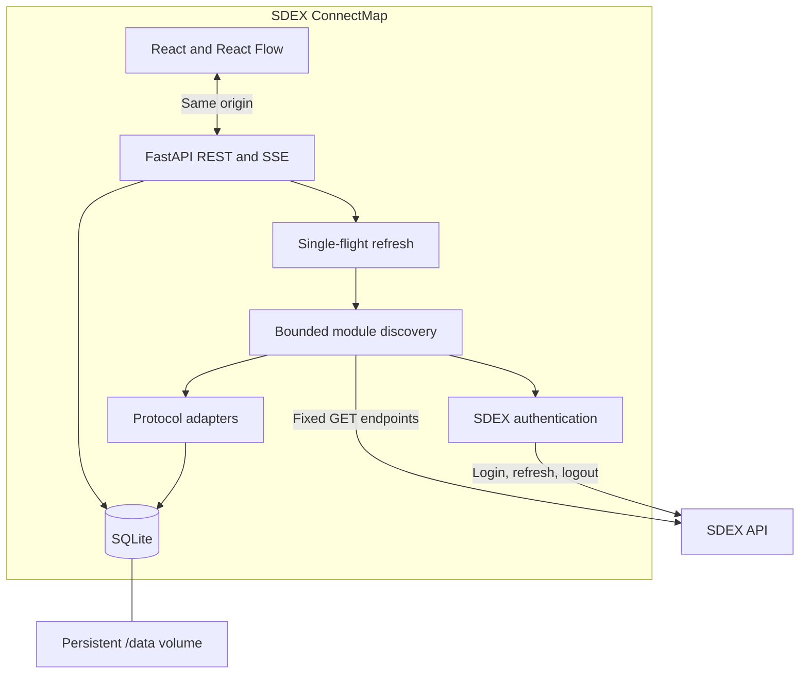
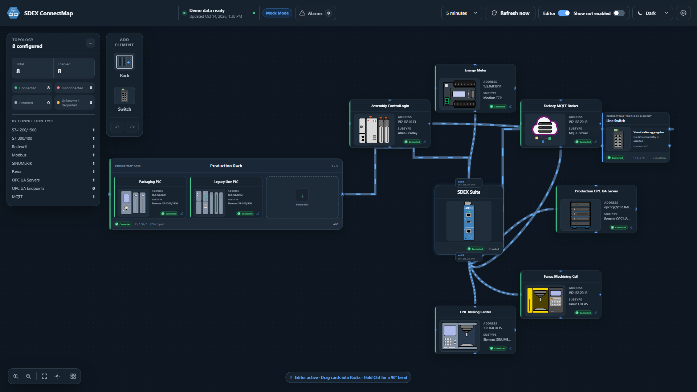

# Architecture

SDEX ConnectMap serves a compiled React frontend and FastAPI REST/SSE API from one origin. The backend owns SDEX credentials, authentication, discovery, scheduling and SQLite persistence. Browser tabs share a snapshot instead of collecting independently.

## Components

| Path | Responsibility |
| --- | --- |
| `backend/app/main.py` | Lifespan, security headers, API wiring and static SPA |
| `backend/app/api/router.py` | Configuration, settings, topology, visual editing, health and event routes |
| `backend/app/core/` | Validated environment settings, credential cipher, redaction and local rate limiting |
| `backend/app/services/sdex_auth.py` | Nonce authentication and bounded session recovery |
| `backend/app/services/sdex_client.py` | Verified TLS, fixed runtime reads, timeouts and retries |
| `backend/app/adapters/` | Per-module response normalization |
| `backend/app/services/discovery.py` | Shared collection, normalized snapshots and stale fallback |
| `backend/app/services/networking.py` | Conservative interface parsing and path assignment |
| `backend/app/services/scheduler.py` | One refresh loop per process |
| `backend/app/services/events.py` | Bounded subscriber queues and completion fan-out |
| `backend/app/services/visual_topology.py` | Local Rack, Switch, membership, link and route rules |
| `backend/app/persistence/database.py` | Schema initialization/migrations and SQLite repositories |
| `frontend/src/` | Forms, topology canvas, editor, connection details and alarms |
| `icons/` | Canonical SVG sources copied by the Vite asset plugin |

## Discovery and updates

Startup initializes storage and starts the scheduler. If a profile exists, it requests an initial refresh. Scheduled, manual and configuration-triggered refreshes use the same single-flight coordinator. The core system read precedes bounded concurrent module reads; unavailable modules produce individual diagnostics rather than turning all missing data into disconnected nodes.

A successful snapshot is saved with stable IDs and joined to existing layout and visual state. When discovery fails, the last useful snapshot remains available with a stale indicator and its previous successful-refresh timestamp.

The event endpoint `/api/events` sends completion notifications and 15-second heartbeats. The UI then fetches the shared topology; it does not receive credentials or raw SDEX session material. EventSource reconnects after interruption, and subscriber queues are removed when streams close. No cross-process event broker exists.

The browser applies only the current topology request's result. Responses from superseded or aborted requests cannot overwrite a newer snapshot after an edit or clear newer refresh state through polling/event callbacks. Rack properties retain unsaved editable fields when refreshes change only aggregate status or position; changed persisted editable fields still update the form.

Mock Mode selects a synthetic client independently of saved real credentials. Its status text describes demo readiness, unavailable demo data or cached demo data, alongside the Mock Mode indicator. Real-mode status text continues to describe SDEX connectivity. The labels do not alter the underlying status calculations, partial-discovery flags or alarms.

## Read-only integration

The adapters read configured S7, Rockwell, Modbus, SINUMERIK, Fanuc, OPC UA and MQTT objects. The optional interface read supports `eth1`/`eth2` assignment. Authentication needs POSTs; discovery uses GETs. No SDEX mutation endpoint is proxied through ConnectMap.

Public API references:

- [SDEX API repository](https://github.com/SoftingIndustrial/SDEXapi)
- [Published SDEX API documentation](https://softingindustrial.github.io/SDEXapi/)

The adapter code and synthetic contract tests describe the response forms currently handled. Module fields and availability remain dependent on the deployed SDEX API; no proprietary SDK is required.

## Interface and visual topology

Assignment uses an explicit compatible interface binding first, then a saved manual override, then longest-prefix matching of a literal device IP against known prefixes. It does not infer names from interface array order, resolve hostnames or invent subnet masks. Unresolved connections stay visible without a fabricated path.

The discovered snapshot is distinct from the local visual layer. Racks group discovered connections; Switches aggregate presentation links. Memberships and uplinks enforce interface consistency and reject duplicate links, self-links and cycles. These elements are not physical switch telemetry.

*The visual editor organizing synthetic connections in offline Mock Mode. Rack memberships and Switch links are local presentation data.*

Cable routes use canvas coordinates. Colors and animation direction are per-edge presentation overrides. Deleting an editor element does not delete a SDEX connection. Visual undo/redo retains up to 100 entries in the current browser session, with `Ctrl+Z`, `Ctrl+Y` or `Ctrl+Shift+Z`; reloading clears it. Connection settings and interface assignment are outside that history.

## Persistence and runtime model

SQLite stores the profile, encrypted password, settings, latest snapshot, layout, viewport, visual elements, memberships, routes and cable styles. It uses WAL and serialized local database operations. Startup migrates supported schemas and rejects an unsupported schema rather than silently recreating it. Back up before upgrades; downgrades are not guaranteed.

The generated credential key lives beside the database unless an external key is supplied. Topology is not encrypted. There is no rolling telemetry or alarm history; alarms reflect the current snapshot.

Run one application process per volume. The scheduler, rate limiter, collection lock and event subscribers are process-local; multiple workers or replicas would create independent collectors. Docker runs only Python at runtime; Node.js is used for building the frontend.
